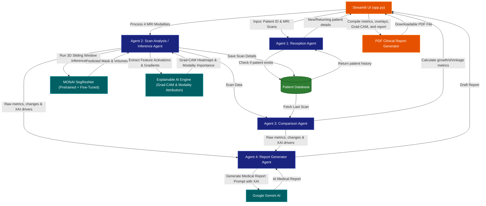

# 🧠 Brain Tumor Analysis System

An AI-powered 3D MRI segmentation, explainability (XAI), and clinical report generation system. It uses a **MONAI SegResNet model** (fine-tuned via transfer learning on the BraTS 2020 dataset) and **Google Gemini AI** to automate brain tumor detection, interpret model decisions, and generate detailed clinical reports.

---

## 🌟 Key Features

1. **AI-Powered 3D Segmentation:** Auto-detects and segments brain tumors into three clinical sub-regions:
   - 🔴 **NCR** (Necrotic Tumor Core)
   - 🟢 **ED** (Peritumoral Edema)
   - 🔵 **ET** (Enhancing Tumor)
2. **Transfer Learning Performance:** Fine-tuned `SegResNet` architecture with `DiceFocalLoss` and data augmentation, achieving **0.7105 Mean Dice** (outperforming the 0.6863 scratch baseline).
3. **Explainable AI (XAI) & Interpretability:** 
   - 🎯 **3D Grad-CAM:** Visualizes deep residual layer attention heatmaps for overall tumor and per-class sub-regions.
   - 📊 **MRI Modality Attribution:** Quantifies sequence importance (FLAIR vs T1 vs T1CE vs T2) using Input × Gradient saliency.
   - 🛡️ **Voxel Confidence Map:** Maps softmax entropy and model certainty across lesion margins.
4. **Multi-Modal Support:** Upload your own FLAIR, T1, T1CE, and T2 scans, or load directly from the BraTS dataset.
5. **Multi-Agent Collaboration:** A cooperative agent system acts like a team of doctors to register patients, run scan inference, compare historical data, and draft reports.
6. **Historical Comparison:** Automatically tracks tumor volume changes (growth/shrinkage) for returning patients.
7. **AI Neuro-Radiologist Reports:** Generates professional medical reports with clinical explainability using Google's Gemini API.
8. **PDF Reports & Visualization:** View overlay images, Grad-CAM attention maps, and download a complete, clinical-style PDF report.

---

## 🚀 How to Run the Project

### 1. Prerequisites
Ensure you have Python installed (Python 3.8+ recommended).

### 2. Install Dependencies
Open your terminal inside the project directory and install the required libraries:
```bash
pip install -r requirements.txt
```

### 3. Configure Environment Variables
Create a file named `.env` in the root folder (this is already ignored by Git for security) and add:
```env
GEMINI_API_KEY=your_gemini_api_key_here
BRATS_DATASET_PATH=C:/path/to/your/brats_dataset  # (Optional)
```

### 4. Run the Streamlit Web Application
Launch the app with Streamlit:
```bash
streamlit run app.py
```
Open the local link (usually `http://localhost:8501`) in your browser to view the application!

---

## 🛠️ Project Structure

- `app.py`: The main Streamlit user interface with interactive XAI dashboard.
- `agents.py`: Orchestrates the AI agents (Reception, Scan, Comparison, Report Generator).
- `model_inference.py`: Runs SegResNet inference and 3D Grad-CAM / Modality Attribution XAI engine.
- `database.py`: Handles patient registration and scan history using PostgreSQL/SQLite.
- `report_generator.py`: Generates printable PDF reports with multi-modal overlays and Grad-CAM visualizations.
- `config.py`: Loads the configuration settings.

---

## 📐 System Architecture

Here is how the data flows through the different cooperative agents inside the system:


